# FruchtDrama — Guide utilisateur (version 0.1.85)

De l'installation à la publication TikTok d'une vidéo complète, étape par étape.

---

## 0. Ce qu'il faut envoyer

**Un seul fichier : `FruchtDrama-0.1.85.zip`.** Il contient le logiciel et ce guide (`GUIDE-UTILISATEUR.pdf`, à la racine du dossier). Il ne contient aucun compte, aucune clé, aucune production : chacun utilise **ses propres comptes** (ChatGPT, Google Flow, et si voulu Claude, Grok, TikTok). Aucun mot de passe n'est demandé.

Envoi conseillé : WhatsApp (en « Document », pas en « Photo »), Google Drive ou e-mail. Message type :

> Voici FruchtDrama. Dézippe `FruchtDrama-0.1.85.zip` dans tes Documents, puis suis `GUIDE-UTILISATEUR.pdf` (dans le dossier) depuis l'étape 1. Il faut Google Chrome, Python 3.11 ou 3.12 et FFmpeg : le guide explique tout.

---

## 1. Installer (une seule fois)

1. Dézipper `FruchtDrama-0.1.85.zip` dans **Documents** : on obtient un dossier `FruchtDrama`. N'importe quel emplacement convient, mais ne lancez rien depuis l'intérieur du zip.
2. Installer **Google Chrome**, **Python 3.11 ou 3.12** 64 bits (python.org, cocher « Add python.exe to PATH ») et **FFmpeg** (Windows : `winget install --id Gyan.FFmpeg --exact` dans un terminal, puis fermer le terminal).
3. Double-cliquer **`Installer.cmd`** (Windows) ou lancer `installer.sh` (Linux). Lire les conditions, taper **ACCEPTER**. L'installation télécharge ce qu'il faut (plusieurs minutes) et **relie ce dossier à Chrome**, sans droits administrateur.
4. C'est tout : **pas besoin de lancer le studio**. L'extension (étape 2) le démarre toute seule, à chaque ouverture de Chrome, même après un redémarrage du PC. Si vous déplacez le dossier, relancez `Installer.cmd` une fois.

Si le studio ne peut pas démarrer, la fenêtre FruchtDrama affiche **« Le studio FruchtDrama ne tourne pas »** avec la raison (installation à faire, port occupé…) et un bouton **Réessayer**. En secours, `Lancer-Studio.cmd` démarre le studio à la main.

## 2. Ajouter l'extension (le « plugin ») à Chrome

1. Dans Chrome, ouvrir **`chrome://extensions`**.
2. Activer **Mode développeur** (en haut à droite).
3. Cliquer **Charger l'extension non empaquetée** et choisir le dossier **`FruchtDrama/extension`**.
4. La carte **FruchtDrama** apparaît avec le logo ci-dessus (le numéro affiché est celui de votre version) :

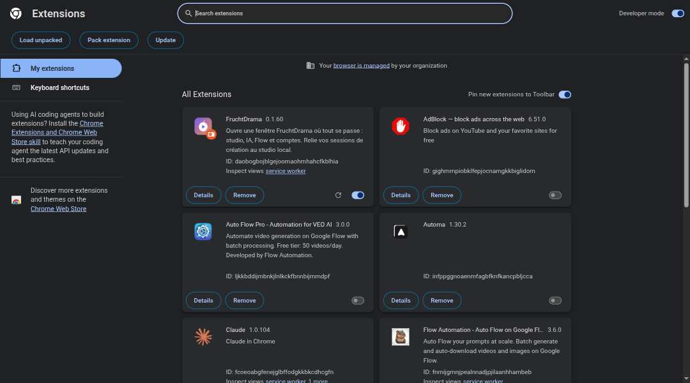

**Après chaque mise à jour** de FruchtDrama : revenir sur `chrome://extensions` et cliquer la flèche ronde **⟳** de la carte FruchtDrama (recharger l'extension). Sans cela, les nouveautés de l'extension (choix du modèle Claude, contrôle de la miniature…) ne marchent pas.

## 3. Épingler l'extension

Cliquer sur la pièce de puzzle de Chrome, puis sur la punaise à côté de **FruchtDrama**. L'icône reste dans la barre (encadrée en orange) :

**Un clic sur cette icône ouvre la fenêtre FruchtDrama** : le studio, plus ChatGPT, Flow et les autres sites dans des onglets, avec vos sessions. **Rien à copier** : l'extension se relie seule au studio.

## 4. Ajouter ses comptes

Page **Mes comptes**, en haut : une carte par site.

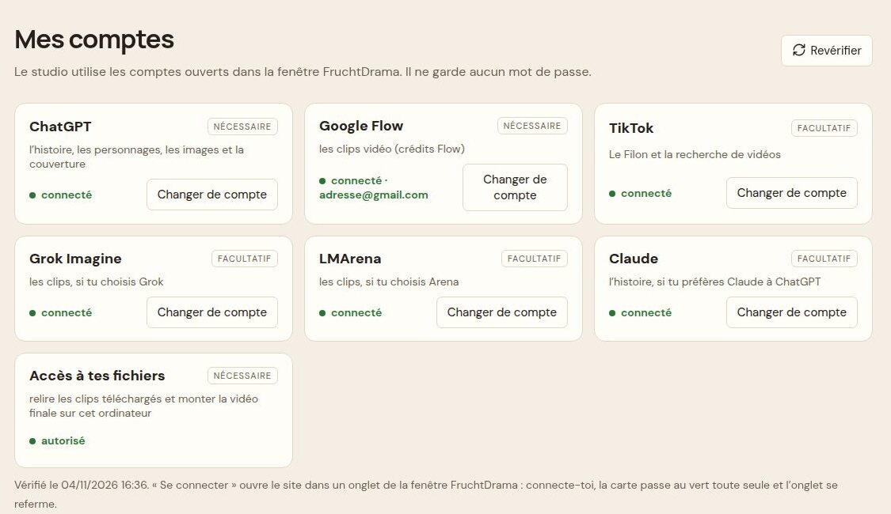

1. Chaque carte dit si vous êtes **connecté**. ChatGPT, Google Flow et « Accès à tes fichiers » sont **nécessaires** ; TikTok, Claude, Grok et LMArena sont facultatifs.
2. **Changer de compte** ouvre le site dans un onglet de la fenêtre : connectez-vous **vous-même**. La carte passe au vert toute seule et l'onglet se referme.

Plus bas, **Comptes Google Flow** : pour utiliser **plusieurs comptes et leurs crédits**.

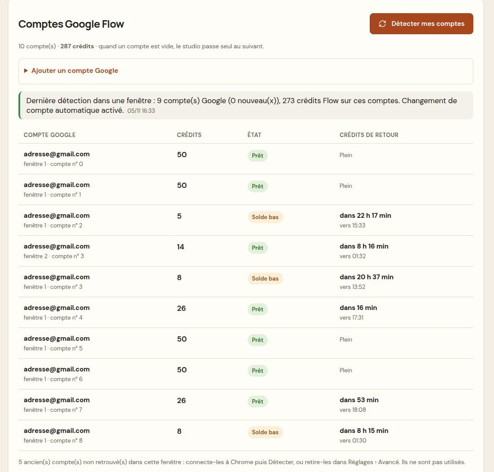

- Dans la fenêtre FruchtDrama, ajoutez chaque compte Google à Chrome : photo de profil en haut à droite d'une page Google › **Ajouter un compte** (ou **Ajouter un compte Google** sur cette page).
- Cliquez **Détecter mes comptes** : le studio lit l'adresse et les **crédits réels** de chaque compte.
- C'est tout : quand un compte n'a plus de crédits, le studio **passe seul au suivant**.
- **État** : **Prêt** (paie au moins un clip), **Solde bas** (ne paie plus un clip : sauté), **Vide** (0 crédit). **Crédits de retour** : l'heure où les crédits gratuits du compte reviennent (24 h après la première dépense).

Bandeau rouge en haut d'une page = un service est à sa limite (ex. « Limite Grok vidéos atteinte, ça revient vers 08:45 »). Attendez, ou connectez un autre compte de ce site puis **J'ai changé de compte**.

## 5. Trouver une idée : Le Filon

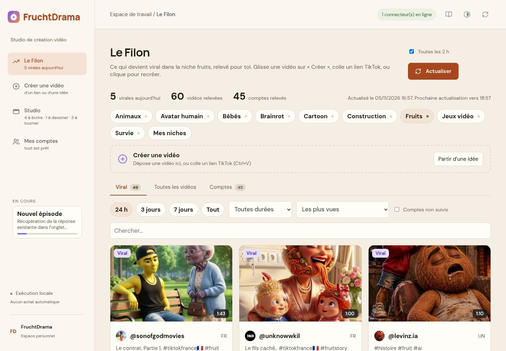

Les vidéos qui marchent, avec leurs **vrais chiffres** : vues, vues par heure, **croissance sur 24 h**, engagement, durée.

- **9 niches** toujours visibles (Animaux, Avatar humain, Bébés, Brainrot, Cartoon, Construction, Fruits, Jeux vidéo, Survie), avec un point d'état ; **Mes niches** pour ajouter les vôtres.
- Onglets **Viral / Toutes les vidéos / Comptes**. Période **24 h** par défaut (puis 3 jours, 7 jours, Tout).
- Durée : toutes, 1 min ou moins, 1 min à 1 min 30, 1 à 2 min, 2 min et plus.
- Tris : les plus vues, les plus rapides, la plus forte croissance, le meilleur engagement, **Au-dessus de leur habitude** (une vidéo qui fait bien mieux que les autres du même compte), **Les plus récentes**.
- Le Filon s'actualise seul **toutes les 2 h** ; le chiffre « virales aujourd'hui » apparaît aussi dans le menu.

**Recréer cette vidéo** lance une histoire inspirée de celle-ci. Vous pouvez aussi glisser une carte sur « Créer une vidéo » ou coller un lien TikTok n'importe où (Ctrl+V).

## 6. Créer une vidéo

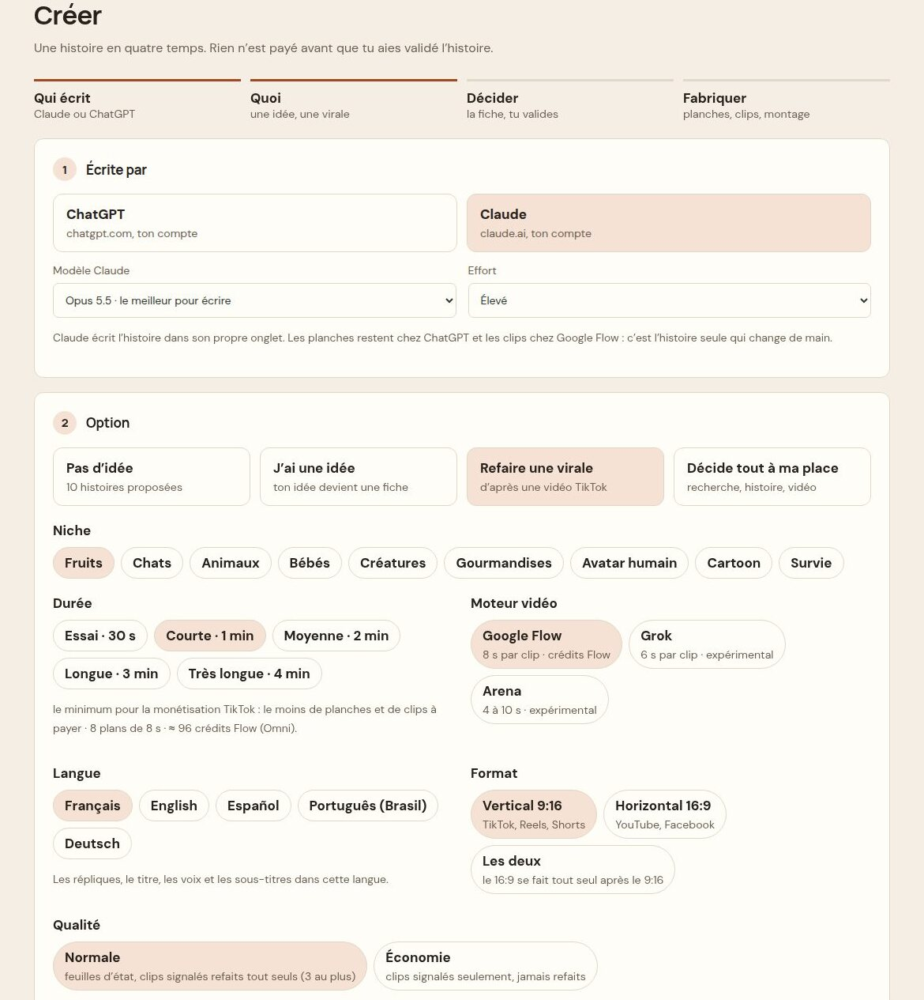

1. **Écrite par** : ChatGPT ou Claude. Avec **Claude**, deux choix en plus :
   - **Modèle Claude** : Opus 5.5 (le meilleur pour écrire, par défaut), Fable 5.1 (le plus puissant) ou Sonnet 5.5 (rapide) ;
   - **Effort** : Élevé (par défaut), Extra ou Moyen.
   Le dernier choix est gardé. Les images restent toujours dessinées par ChatGPT et les clips faits par Google Flow : seule l'histoire change de main.
2. **Option** : *Pas d'idée* (10 histoires proposées), *J'ai une idée*, *Refaire une virale* (lien TikTok, voir 6 bis), *Décide tout à ma place*.
3. **Niche** : 9 choix (Fruits, Chats, Animaux, Bébés, Créatures, Gourmandises, Avatar humain, Cartoon, Survie).
4. **Durée** : Essai · 30 s, **Courte · 1 min (le minimum pour être payé par TikTok)**, Moyenne · 2 min, Longue · 3 min, Très longue · 4 min. Le nombre de plans et le coût Flow estimé s'affichent dessous.
5. **Moteur vidéo** : Google Flow (conseillé), Grok ou Arena (expérimentaux).
6. **Langue** : **cinq langues** — Français, English, Español, Português (Brasil), Deutsch. Répliques, titre, voix et sous-titres sont dans cette langue.
7. **Format** (Vertical 9:16, Horizontal 16:9, Les deux) et **Qualité** (Normale, ou Économie : moins de contrôles, rien n'est refait).
8. **Fabrication** : « Lancer la production automatiquement » coché = tout s'enchaîne après la fiche ; décoché = vous validez la fiche vous-même avant tout paiement. Puis **Personnages** (Simple ou Détaillé), **Sous-titres** (Sans ou Avec karaoké), **Essai à blanc des clips** (tout est préparé, rien n'est envoyé ni payé) et **Réglages Flow**.

Puis : choisir une des **dix histoires**, relire la **fiche de décision** et **Valider**. Rien n'est payé avant.

### 6 bis. Refaire une virale

Choisir l'option **Refaire une virale** : la partie 3 devient « La vidéo à refaire ».

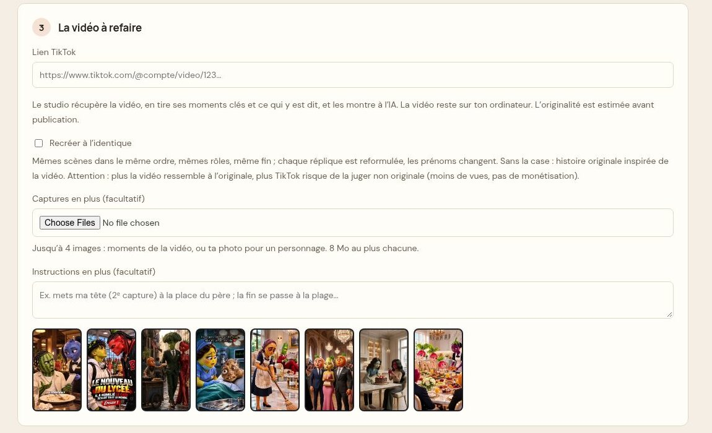

- **Lien TikTok** de la vidéo. Le studio la récupère, en tire les moments clés et ce qui est dit, et les montre à l'IA. La vidéo reste sur votre ordinateur.
- Case vide : une **histoire originale inspirée** de la vidéo (même mécanique d'émotion, autres personnages, lieux et répliques).
- Case **Recréer à l'identique** cochée : **la même histoire, scène par scène** — mêmes personnages, mêmes lieux, mêmes événements, même fin ; seules les répliques sont reformulées et les prénoms changent. Attention : plus c'est proche de l'original, plus TikTok risque de juger la vidéo non originale (moins de vues, pas de rémunération).
- **Captures en plus** (jusqu'à 4 images, par exemple votre photo pour un personnage) et **Instructions en plus** : facultatifs.

En bas de la page, **Vidéos déjà récupérées** liste les vidéos déjà refaites, avec **Ouvrir l'épisode** :

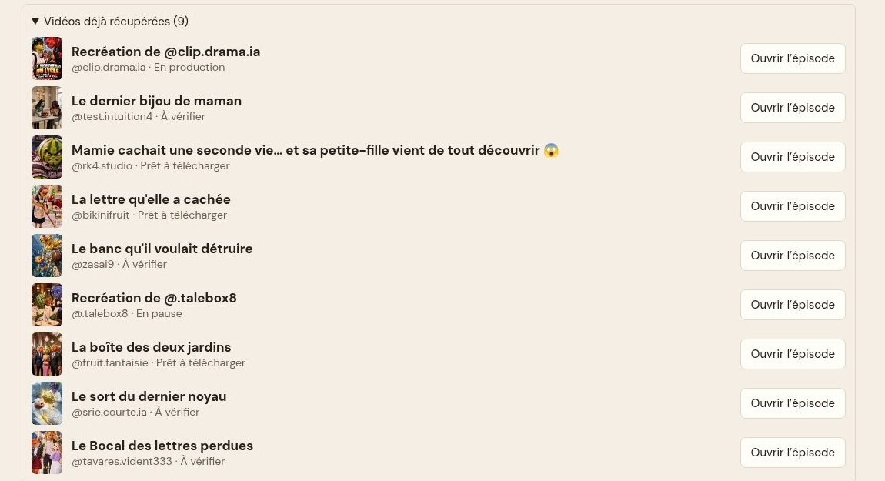

## 7. Des histoires construites sur l'émotion

Toutes les histoires suivent ce qui fait les vidéos virales :

- une **victime attachante** et un **antagoniste détestable** (patronne qui humilie, belle-mère cruelle, milliardaire déguisé, épouse trahie, fille rejetée, enfant moqué, fils ingrat, fausse accusation…) ;
- une **injustice qui s'aggrave**, puis un **basculement** et une **revanche visible** ;
- des réactions qui se voient sur les visages, et des **transitions qui laissent une tension** pour donner envie de voir la suite ;
- un **appel de fin** (trois au choix dans la fiche, modifiables).

La **fiche de décision** montre tout avant de payer : moteur de l'histoire, obstacle, retournement, 3 titres, 3 premières répliques, appel de fin, casting.

## 8. Suivre la fabrication : Studio

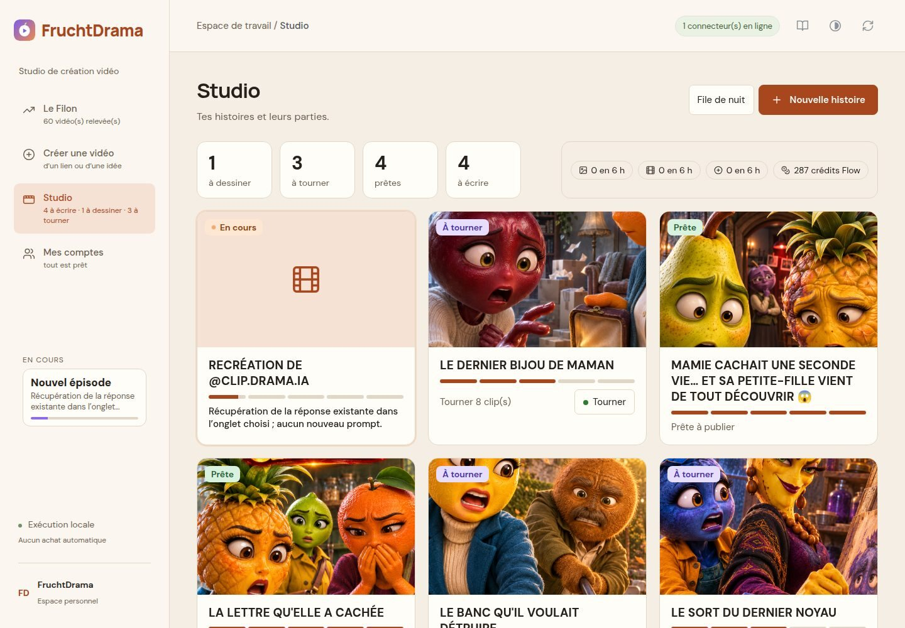

Une carte par histoire : étape (**À écrire, À dessiner, À tourner, Prête**), barre de progression, **prochaine action** et son bouton direct. Les compteurs en haut sont comptés par histoire. Une histoire en fabrication porte la pastille **En cours**, et la carte **En cours** du menu montre ce qui se passe maintenant.

Cliquer une histoire montre ses **parties** et ses personnages ; **Créer la partie 2** fait la suite avec les mêmes personnages (rien à repayer pour eux) :

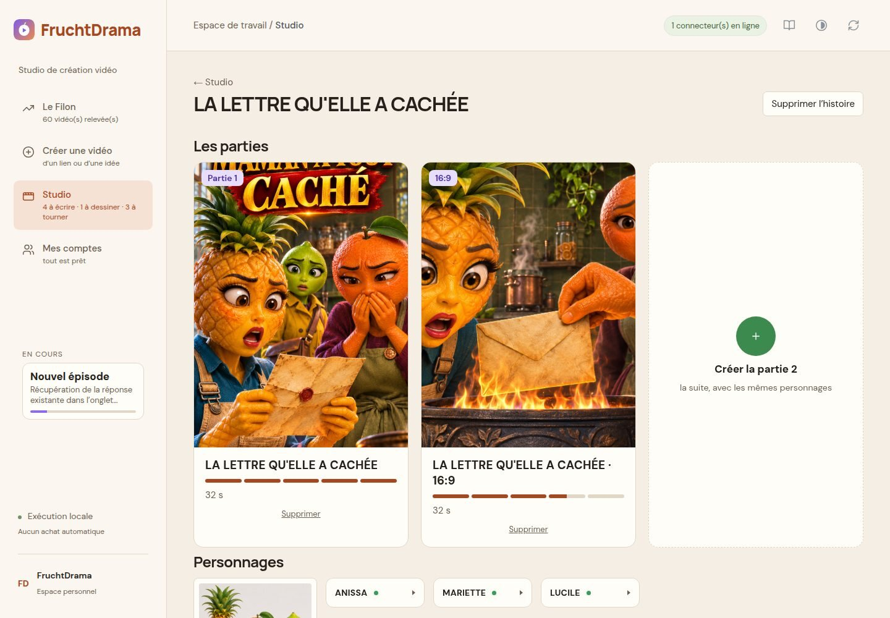

## 9. La page de l'épisode

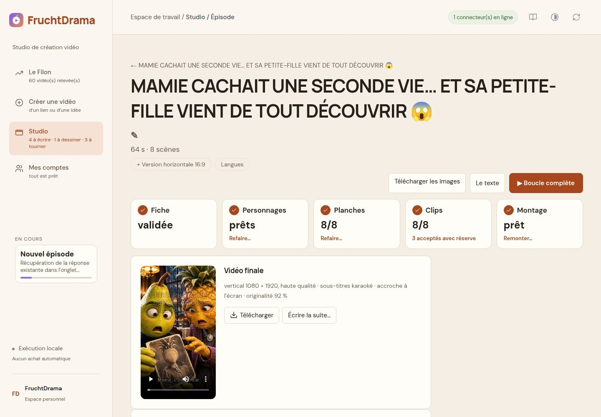

- Cinq cases : **Fiche, Personnages, Planches, Clips, Montage** (avec Refaire… / Générer / Remonter…).
- **Vidéo finale** : 1080 × 1920, sous-titres karaoké, **accroche écrite à l'écran les 3 premières secondes**, score d'originalité. **Télécharger**, **Écrire la suite…**.
- **+ Version horizontale 16:9** et **Langues** créent une version liée.

### ▶ Boucle complète : elle décide seule

**▶ Boucle complète** reprend exactement là où ça s'est arrêté et va jusqu'à la vidéo finale. Aux contrôles qualité, **elle décide seule** : des paroles un peu différentes du texte ou une petite réserve sur l'image sont **acceptées sans nouveau crédit**, et le montage continue. Seul un fichier illisible l'arrête. **Pause** vous rend la main.

Un **bandeau en haut de l'épisode** dit ce qui demande votre regard :

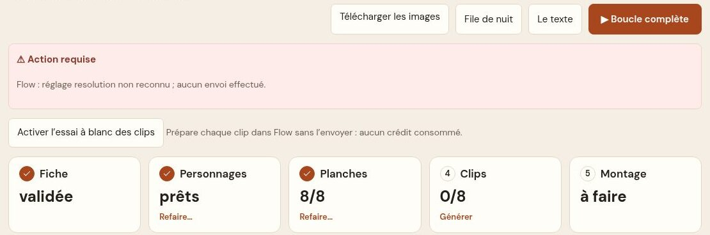

- **Rouge « Action requise »** : le studio vous attend (la raison est écrite). Faites ce qui est demandé, puis **▶ Boucle complète**.
- **Orange « Décidé automatiquement — à vérifier avant de publier »** : les scènes acceptées seules par la boucle. Regardez-les avant de publier.

### Personnages

Une **pastille par personnage** (nom, point vert s'il est dessiné). Un clic la déplie : description, image, **Remplacer**. À côté du titre, **Simple | Détaillé** choisit le niveau tant que rien n'est dessiné ; ensuite seul le niveau choisi s'affiche. **Refaire** est à droite.

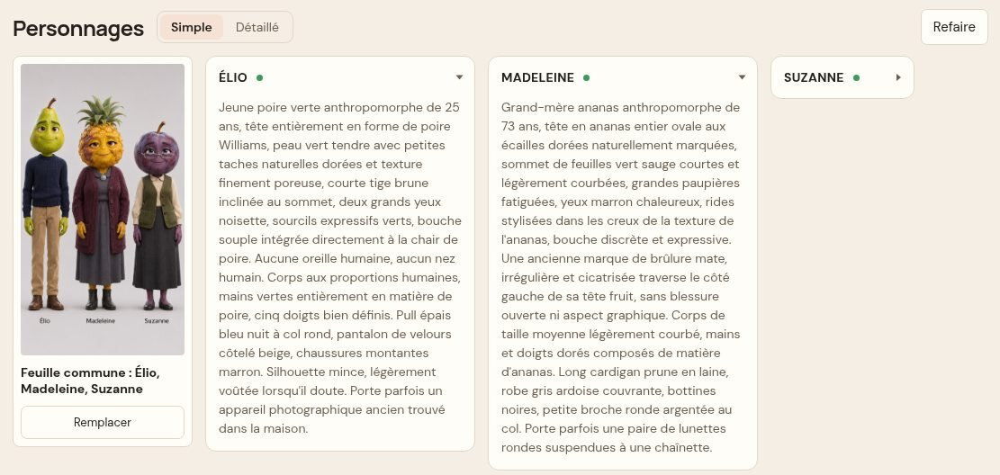

**Au fil de l'histoire** : quand l'histoire change vraiment l'apparence d'un personnage (blessure, vêtement déchiré, maquillage qui coule…), une section apparaît sous les personnages : « Dès la scène N », « NOM : changement ». En qualité **Normale**, ChatGPT redessine la feuille du personnage avec ce changement, et toutes les planches suivantes l'utilisent : l'apparence reste la même jusqu'à la fin. En Économie, pas de feuille d'état.

### Scènes

Un clic sur une scène montre **la planche et le clip côte à côte**, les répliques, ce qui a été entendu, et les boutons **Copier le prompt**, **Modifier le texte**, **Remplacer**, **Refaire…** :

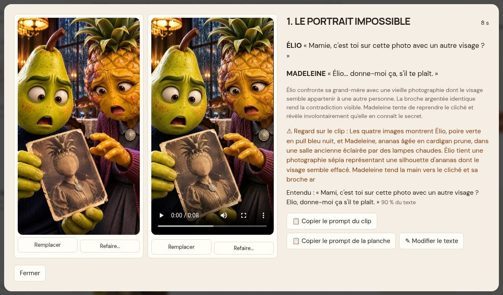

## 10. Avant de publier : miniature, hook et originalité

- **Miniature contrôlée** : pendant la boucle complète, ChatGPT regarde la miniature et la redessine une fois s'il voit un défaut (titre coupé ou mal écrit, visage déformé, personnage qui ne ressemble pas). Réglage dans Mes comptes (section 12).
- **Hook** : la scène 1 s'ouvre sur l'instant le plus fort, la première réplique choc tombe dans les 2 premières secondes, et une **accroche est écrite à l'écran**.
- **Originalité** (bouton **Contrôler** sous la miniature) : un **pourcentage estimé** et une recommandation.

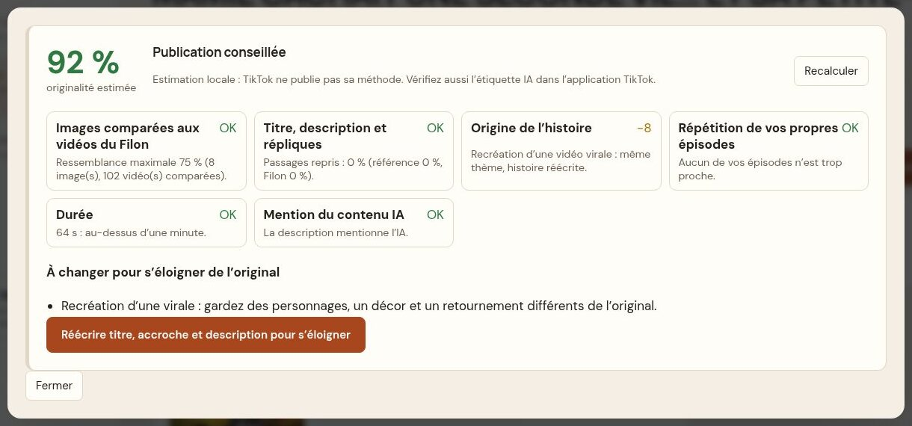

| Score | Que faire |
|---|---|
| 80 % et plus | **Publication conseillée** |
| 60 à 79 % | **Corrigez avant de publier** : suivez les conseils, ou **Réécrire titre, accroche et description pour s'éloigner** |
| moins de 60 % | **Publication déconseillée** : refaites les planches signalées ou recréez l'histoire |

Estimation locale : TikTok ne publie pas sa méthode. Elle compare vos images aux vidéos du Filon, vos textes à la vidéo d'origine, signale la répétition de vos propres épisodes, la durée (moins d'1 min = pas de rémunération) et l'absence de mention IA.

## 11. Publier sur TikTok

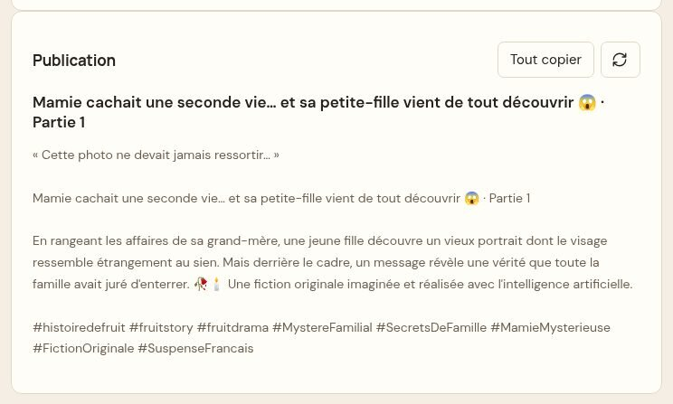

Le bloc **Publication** est prêt à coller : **accroche** entre guillemets, **« Titre · Partie N »**, description, **appel de fin**, puis **hashtags de la niche**.

1. Vidéo finale › **Télécharger** (MP4 1080 × 1920).
2. Miniature › **Télécharger** ; Publication › **Tout copier**.
3. Dans TikTok (téléphone ou tiktok.com/upload) : importer le MP4, coller le texte, choisir la miniature, **activer « Contenu généré par l'IA »**, publier.
4. Pour une série : **Écrire la suite…** sur l'épisode, ou **Créer la partie 2** sur la page de l'histoire.

## 12. Réglages (Mes comptes)

Sous les comptes, les **Réglages sont ouverts** : langue des nouveaux épisodes, montage (transitions, coupes rapides, silences, karaoké), contrôles, sauvegardes, **En cas de souci**, **Apparence**, et Avancé (plié).

**Contrôles et essai à blanc** : ce que la boucle complète vérifie pour les planches, les clips et **la miniature** (Corriger toute seule / Signaler seulement / Pas de contrôle), et si ChatGPT regarde aussi les clips.

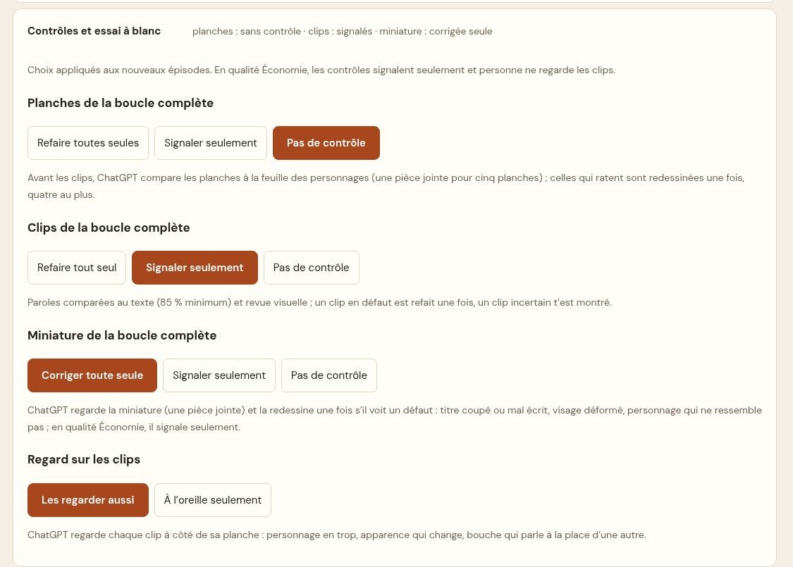

**En cas de souci** : **Copier le rapport de panne**, puis le coller dans votre message à votre formateur (ni mot de passe, ni code, ni adresse e-mail dedans). **Apparence** : **7 palettes** — Ardoise, Laiton, Lagon, Cinéma, **Papier** (clair, celle de départ), Verre, Éditorial. Le bouton rond en haut de l'écran passe de Papier à Ardoise et inversement.

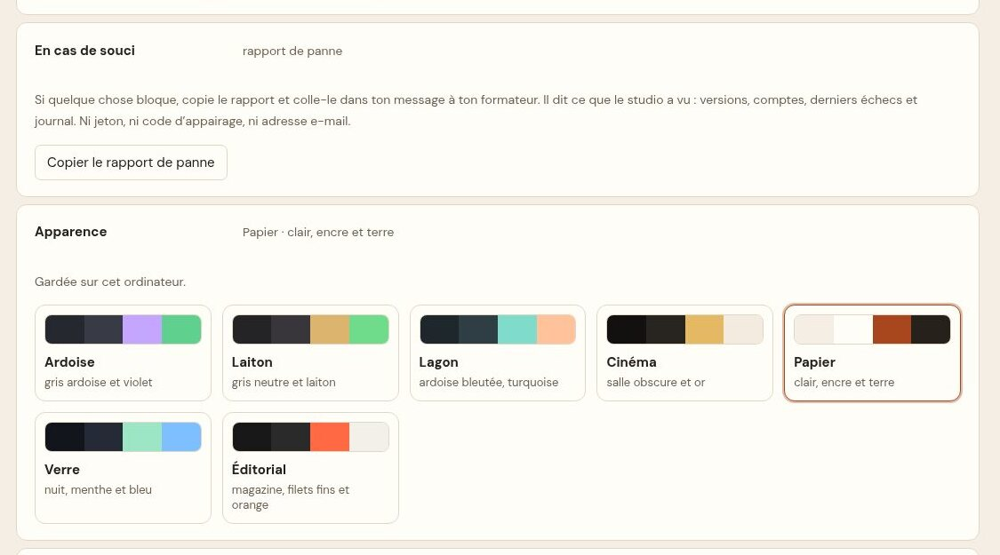

## 13. En cas de souci

- **Bandeau rouge « Limite atteinte »** : attendre l'heure indiquée, ou changer de compte puis « J'ai changé de compte ».
- **Flow « Solde bas »** partout : ajoutez des comptes Google avec des crédits, puis **Détecter mes comptes**.
- **Connexion requise / vérification anti-robot** : la faire vous-même dans l'onglet, puis **▶ Boucle complète**. FruchtDrama ne contourne jamais ces vérifications.
- **Une nouveauté ne marche pas après une mise à jour** : recharger l'extension (`chrome://extensions` › **⟳** sur la carte FruchtDrama).
- Sinon : Mes comptes › **En cas de souci** › **Copier le rapport de panne**.

*FruchtDrama — studio local. Aucun achat automatique, aucun mot de passe enregistré.*
