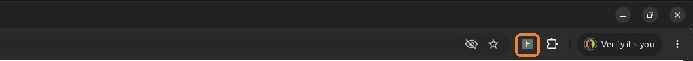
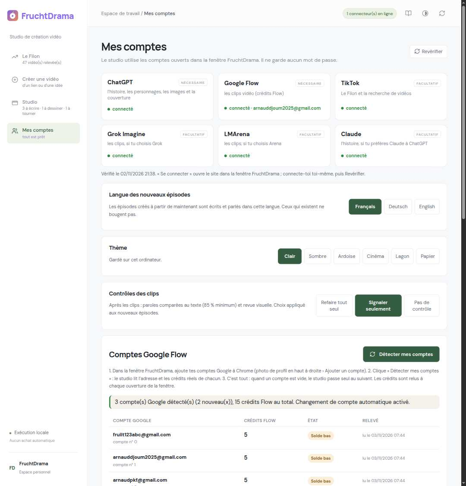
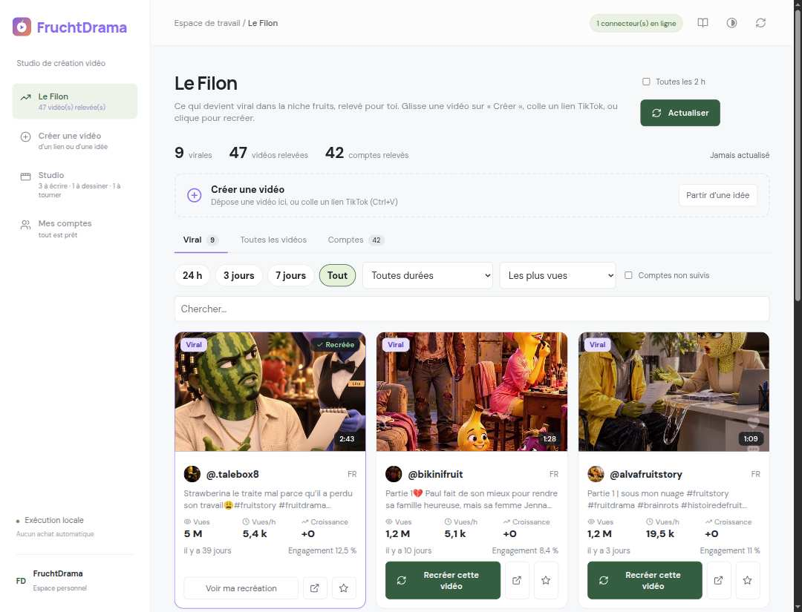
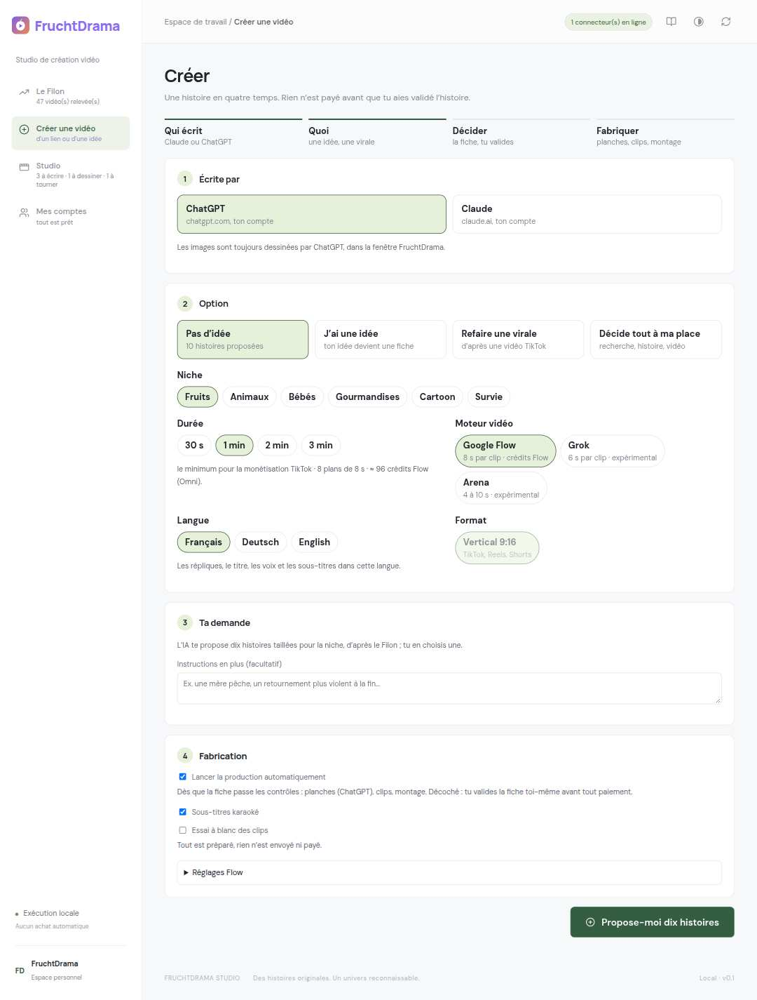
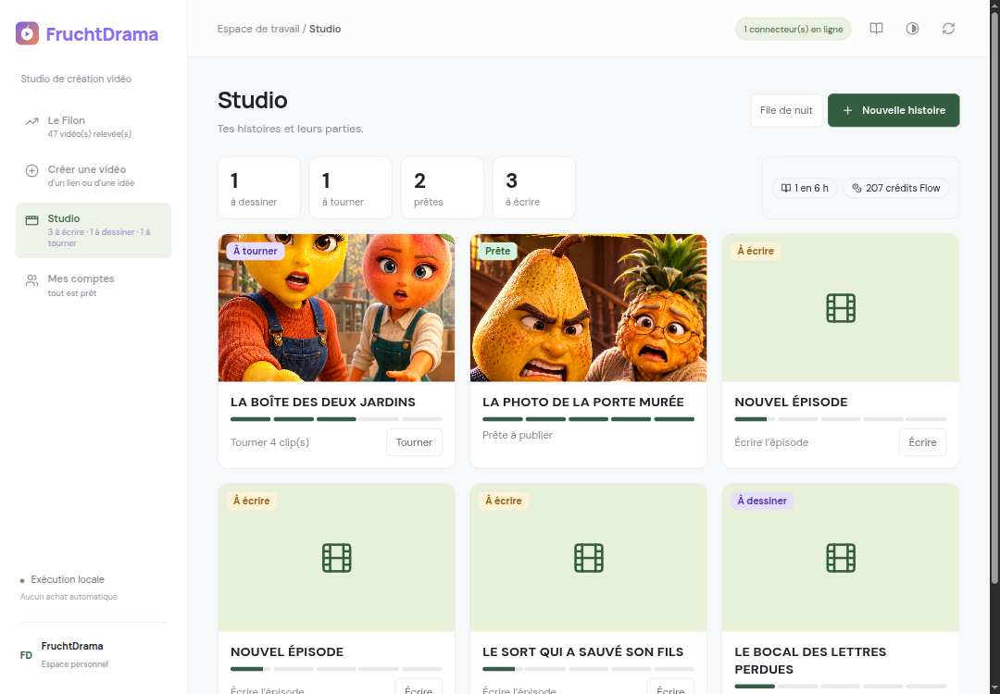
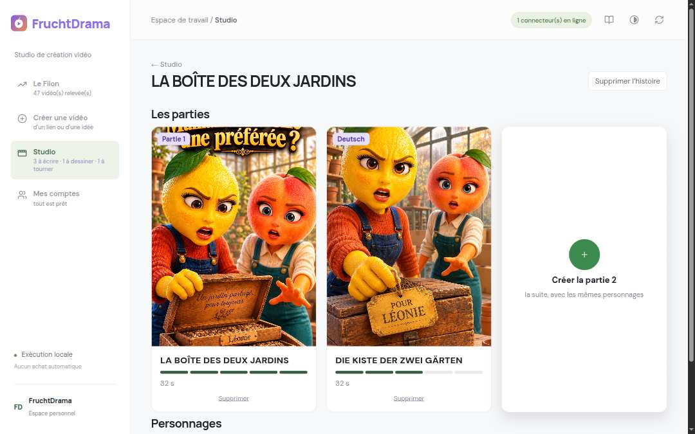
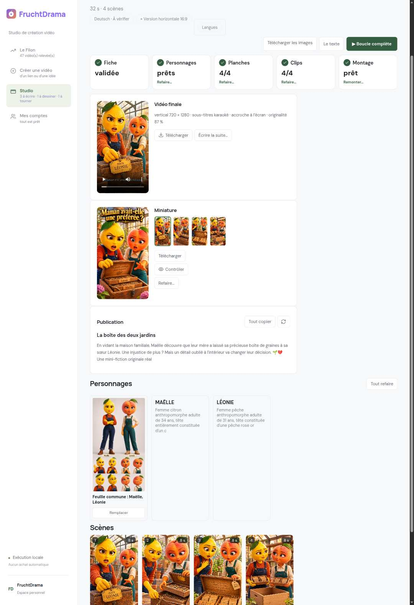
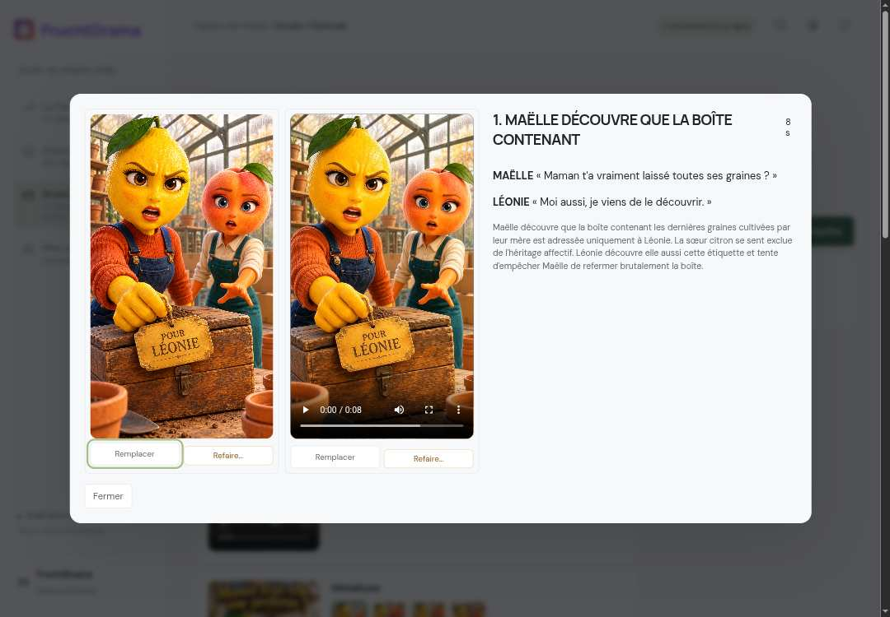
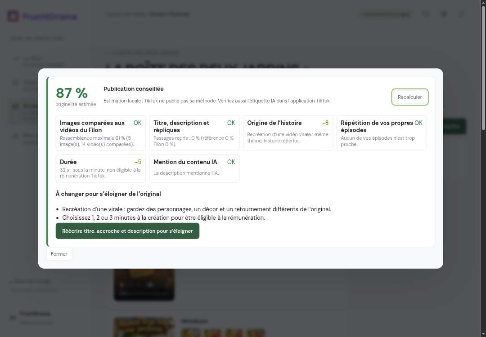

# FruchtDrama — Guide utilisateur (version 0.1.60)

De l'installation à la publication TikTok d'une vidéo complète, étape par étape.

---

## 0. Ce qu'il faut envoyer à un abonné

| À envoyer | Nom exact du fichier | Où le trouver |
|---|---|---|
| Le logiciel complet | **`FruchtDrama-a-partager.zip`** | Bureau › dossier `FruchtDrama` |
| Ce guide | **`GUIDE-UTILISATEUR.pdf`** | Bureau › `FruchtDrama` › `Documentation` |

Envoi conseillé : WhatsApp (en « Document », pas en « Photo »), Google Drive ou e-mail (le zip fait environ 3 Mo). Message type :

> Voici FruchtDrama. 1) Dézippe `FruchtDrama-a-partager.zip` dans tes Documents. 2) Suis `GUIDE-UTILISATEUR.pdf` depuis l'étape 1. Il faut Google Chrome, Python 3.11 ou 3.12 et FFmpeg (le guide explique tout).

L'abonné doit avoir **ses propres comptes** (ChatGPT, Google Flow, et si voulu Grok, Claude) : rien n'est partagé, aucun mot de passe n'est demandé.

---

## 1. Installer (une seule fois)

1. Dézipper `FruchtDrama-a-partager.zip` dans **Documents** (dossier `FruchtDrama`).
2. Installer **Python 3.11 ou 3.12** (python.org, cocher « Add Python to PATH ») et **FFmpeg** (le studio indique s'il le trouve).
3. Double-cliquer **`Installer.cmd`** (Windows) ou lancer `installer.sh` (Linux).
4. Double-cliquer **`Lancer-Studio.cmd`** : le studio démarre sur `http://127.0.0.1:8840`.

## 2. Ajouter l'extension (le « plugin ») à Chrome

1. Dans Chrome, ouvrir **`chrome://extensions`**.
2. Activer **Mode développeur** (en haut à droite).
3. Cliquer **Charger l'extension non empaquetée** et choisir le dossier **`FruchtDrama/extension`**.
4. La carte **FruchtDrama** apparaît avec le logo ci-dessus :

## 3. Épingler l'extension

Cliquer sur la pièce de puzzle de Chrome, puis sur la punaise à côté de **FruchtDrama**. L'icône reste dans la barre (encadrée en orange) :

**Un clic sur cette icône ouvre la fenêtre FruchtDrama** : le studio, plus ChatGPT, Grok et Flow dans des onglets, avec vos sessions. À l'ouverture, les sites sont revérifiés et les crédits de vos comptes relus. **Rien à copier** : l'extension se relie seule au studio (clé cachée).

## 4. Ajouter ses comptes

Page **Mes comptes** :

1. **Sites** (en haut) : chaque carte dit si vous êtes connecté. « Se connecter » ouvre le site dans la fenêtre ; connectez-vous **vous-même** une fois (ChatGPT obligatoire, Google Flow obligatoire, les autres facultatifs).
2. **Comptes Google Flow** — pour utiliser **plusieurs comptes et leurs crédits** :
   - dans la fenêtre FruchtDrama, ajoutez chaque compte Google à Chrome : photo de profil en haut à droite d'une page Google › **Ajouter un compte** ;
   - cliquez **Détecter mes comptes** : le studio lit l'adresse et les **crédits réels** de chaque compte ;
   - c'est tout : quand un compte n'a plus de crédits, le studio **passe seul au suivant**.
3. États d'un compte Flow : **Prêt** (paie au moins un clip), **Solde bas** (ne paie plus un clip à 12 crédits : sauté), **Vide** (0 crédit).
4. Réglages de la même page : **langue** des nouveaux épisodes, **thème**, **contrôles des clips** (Refaire tout seul / Signaler seulement / Pas de contrôle).

Bandeau rouge en haut d'une page = un service est à sa limite (ex. « Limite Grok vidéos atteinte, ça revient vers 08:45 »). Attendez, ou connectez un autre compte de ce site puis **J'ai changé de compte**.

## 5. Trouver une idée : Le Filon

Les vidéos qui marchent dans la niche, avec leurs **vrais chiffres** (vues, vues/h, croissance, engagement, durée). Onglets **Viral / Toutes les vidéos / Comptes**, filtres de période et de durée (« 1 à 3 min, monétisables »). **Recréer cette vidéo** lance une histoire originale inspirée de celle-ci. Vous pouvez aussi glisser une carte sur « Créer » ou coller un lien TikTok n'importe où.

## 6. Créer une vidéo

1. **Écrite par** : ChatGPT (ou Claude).
2. **Option** : *Pas d'idée* (10 histoires proposées), *J'ai une idée*, *Refaire une virale* (lien TikTok), *Décide tout à ma place*.
3. **Durée** : 30 s (essai), **1 min (minimum pour la rémunération TikTok)**, 2 min, 3 min — le nombre de plans et le coût Flow estimé s'affichent.
4. **Moteur vidéo** (Flow, Grok, Arena), **langue**, format vertical.
5. **Fabrication** : « Lancer la production automatiquement » coché = tout s'enchaîne après la fiche ; décoché = vous validez la fiche vous-même. Réglages Flow : modèle, **résolution 1080p** si votre compte la propose.

Puis : choisir une des **dix histoires**, relire la **fiche de décision** (moteur, obstacle, twist, 3 titres, 3 premières répliques, appel de fin, casting) et **Valider**. Rien n'est payé avant.

## 7. Suivre la fabrication : Studio

Une carte par histoire : étape (À écrire, À dessiner, À tourner, À finir, Prête), barre de progression, **prochaine action** et son bouton direct. En bas à gauche du menu, **En cours** montre la production en train d'être faite. Cliquer une histoire montre ses **parties** :

Puis la page de la partie :

- cinq cases : Fiche, Personnages, Planches, Clips, Montage (avec Refaire… / Générer / Monter…) ;
- **▶ Boucle complète** reprend exactement là où ça s'est arrêté ;
- **Vidéo finale** : 1080 × 1920, sous-titres karaoké, **accroche (hook) écrite à l'écran les 3 premières secondes** ;
- Miniature, Publication, Personnages, Scènes. Un clic sur une scène montre **la planche et le clip côte à côte** :

## 8. Avant de publier : hook et originalité

- **Hook** : la scène 1 s'ouvre sur l'instant le plus fort, la première réplique choc tombe dans les 2 premières secondes, et une **accroche est écrite à l'écran** (dernier mot en jaune). C'est ce qui retient les spectateurs.
- **Originalité** (bouton **Contrôler** sous la miniature) : un **pourcentage estimé** et une recommandation.

| Score | Que faire |
|---|---|
| 80 % et plus | **Publication conseillée** |
| 60 à 79 % | **Corrigez avant de publier** : suivez les conseils, ou **Réécrire titre, accroche et description pour s'éloigner** |
| moins de 60 % | **Publication déconseillée** : refaites les planches signalées ou recréez l'histoire |

Estimation locale : TikTok ne publie pas sa méthode. Elle compare vos images aux vidéos relevées, vos textes à la vidéo d'origine, signale la répétition de vos propres épisodes, la durée (moins d'1 min = pas de rémunération) et l'absence de mention IA.

## 9. Publier sur TikTok

1. Page de la partie › Vidéo finale › **Télécharger** (MP4 1080 × 1920).
2. Miniature › **Télécharger** ; Publication › **Tout copier** (titre et description avec hashtags).
3. Dans TikTok (téléphone ou tiktok.com/upload) : importer le MP4, coller la description, choisir la miniature, **activer « Contenu généré par l'IA »**, publier.
4. Pour une série : **Créer la partie 2** sur la page de l'histoire (mêmes personnages, rien à repayer pour eux).

## 10. En cas de souci

- **Bandeau rouge « Limite atteinte »** : attendre l'heure indiquée ou changer de compte puis « J'ai changé de compte ».
- **Flow « Solde bas »** partout : ajoutez des comptes Google avec des crédits, puis **Détecter mes comptes**.
- **Connexion requise / vérification anti-robot** : la faire vous-même dans l'onglet, puis **▶ Boucle complète**. FruchtDrama ne contourne jamais ces vérifications.
- Mes comptes › Réglages › **Assistance** › Copier un rapport de panne (sans mot de passe ni adresse).

*FruchtDrama — studio local. Aucun achat automatique, aucun mot de passe enregistré.*
